# Planning and Control Stack for Dexterous Hands

**Abdullah Sohail · Anush Lakshman · Harisankar**

A robot hand **learns its own dynamics model from self-exploration**, then plans and controls with it. Two controller stacks are
compared on simulated hands in Isaac Sim 4.2 / Isaac Lab 1.2:

| Stack | What it does |
|---|---|
| **CEM-MPC** | Sampling-based MPC: sample command sequences, roll them through the learned model, refit to the best ones, replan. |
| **RRT + iLQR-MPC/TVLQR + CBF** | RRT-Connect plans a collision-free path in joint space. iLQR-MPC tracks it, with TVLQR feedback between solves. A control barrier function (CBF) filter minimally edits each command so fingers never go through each other. If the filter fails, the hand holds and RRT replans. |

The repository has two parts:

| Folder | Hand | Model the hand identifies by itself |
|---|---|---|
| [`SHADOW/`](SHADOW) | Shadow Dexterous Hand: 24 joints, 20 tendon-driven actuators | tendon dynamics (Li et al. form), 388 parameters |
| [`INSPIRE/`](INSPIRE) | Inspire RH56: 6 linear servos driving 12 joints through linkages (the hand in our lab) | servo–linkage model |

<p align="center">
  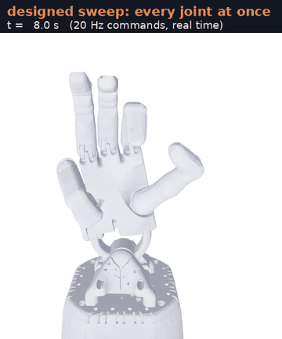
  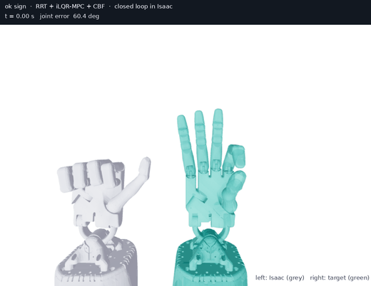
  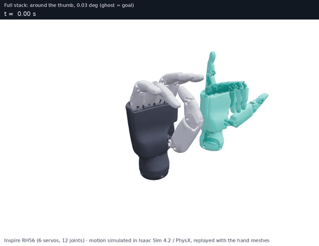
</p>

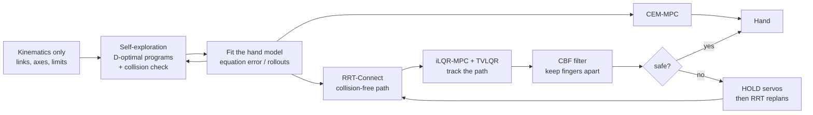

## Results

### Shadow Hand: gesture reaching

Each task is a move to one of 15 gestures in 6 s; success means final joint error below 2°. There are 450 tasks (3 seeds × 150),
and every controller uses the model the hand identified itself (experiment 50).

| Controller | Success | Fingertip < 5 mm | Mean joint error | Steps with penetration |
|---|--:|--:|--:|--:|
| direct command | 74.4% | 0.0% | 2.09° | 6.85% |
| CEM-MPC | 85.3% | 63.1% | 1.66° | 4.92% |
| iLQR-MPC + TVLQR | 94.4% | 90.2% | 1.02° | 3.09% |
| RRT + iLQR-MPC | 99.8% | 96.4% | 0.72° | 0.91% |
| **RRT + iLQR-MPC + CBF** | **100%** | **99.6%** | **0.68°** | **0.77%** |

In each pair below, CEM-MPC (left) ends in the wrong gesture and the full stack (right) reaches it. The goal is the green ghost.

<p align="center">
  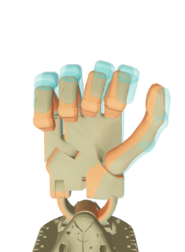
  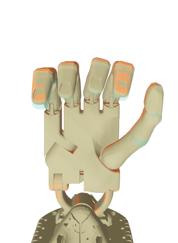
  &nbsp;&nbsp;
  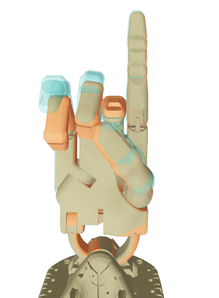
  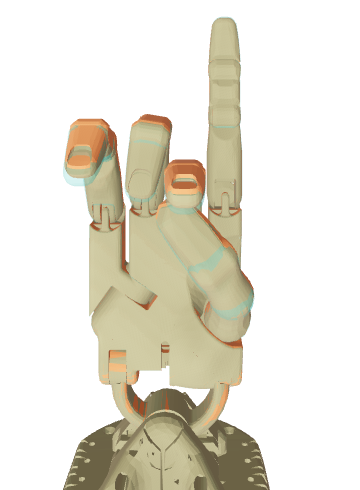
</p>
<p align="center"><sub>Cylindrical grasp: CEM 25.6° → stack 0.59° &nbsp;·&nbsp; Thumb–ring pinch: CEM 16.7° → stack 0.50°</sub></p>

| CEM-MPC | RRT + iLQR-MPC/TVLQR |
|:--:|:--:|
|  | 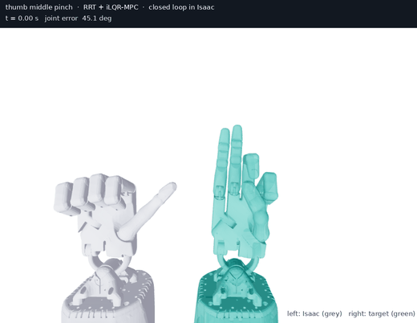 |

### Shadow Hand: in-hand cube reorientation

Each task turns a 6 cm cube to a goal orientation in 10 s. There are 240 paired cases (experiment 51).

| Controller | Success |
|---|--:|
| **CEM-MPC** (PPO proposals, Isaac cube in the planner) | **64.6%** |
| CEM + RRT + iLQR-MPC + CBF | 36.7% |

On the cube the stack *hurts*: each layer edits CEM's commands using a hand model that knows nothing about the cube. A cube-aware
version (experiment 54) adds:

- contact-aware TVLQR references;
- an overlap cost;
- a light CBF.

It reaches 93.3% with a 20 s cap, against 71.7% for the plain stack and 85.8% for CEM.

| CEM-MPC: solved in 3.9 s | CEM + stack: ends 16.8° off |
|:--:|:--:|
|  | 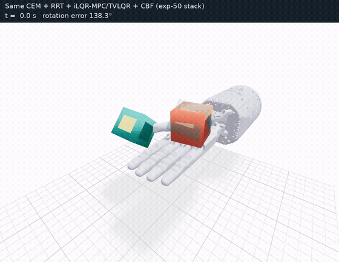 |

### Inspire RH56

**Self-exploration (experiment 02).**

- 15 s of closed-loop exploration predicts free motion to 0.03°; the spec model is off by 0.74°.
- The servo speed limits come out within 1% of the truth.
- Finger contact while exploring is 0%, against 11–15% for random motion.

| Closed-loop exploration (collision-screened) | Random exploration |
|:--:|:--:|
| 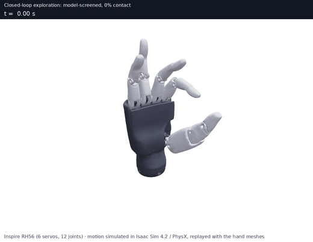 | 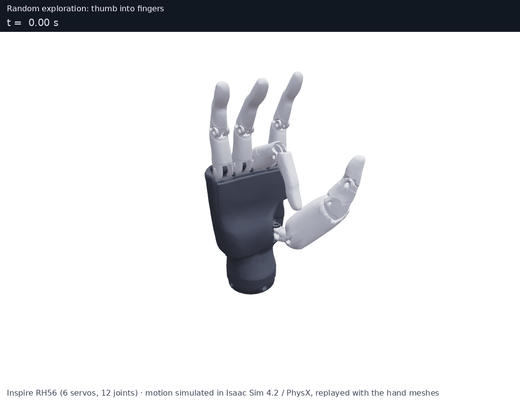 |

**Crossing gestures (experiment 03).** These are transitions whose straight-line move would drive the thumb through a finger: 360
tasks, success means final error below 2°.

| Controller | Success | Finger contact (steps) |
|---|--:|--:|
| direct command | 95.6% | 8.6% |
| CEM-MPC | 95.0% | – |
| iLQR-MPC + TVLQR | 96.7% | – |
| CEM + CBF (no planner) | 88.6% (deadlocks) | – |
| RRT + iLQR-MPC | 100% | – |
| **Full stack + fallback** | **100%** | **1.4%** |

The fallback (hold, then replan) fired 9 times and recovered every time. On one hand and one CPU core the full stack takes about
97 ms per 150 ms cycle, so it runs in real time.

| No safety layer: thumb 2.7 mm inside the index finger | Full stack, same task and moment: gap ≥ 4.7 mm |
|:--:|:--:|
| 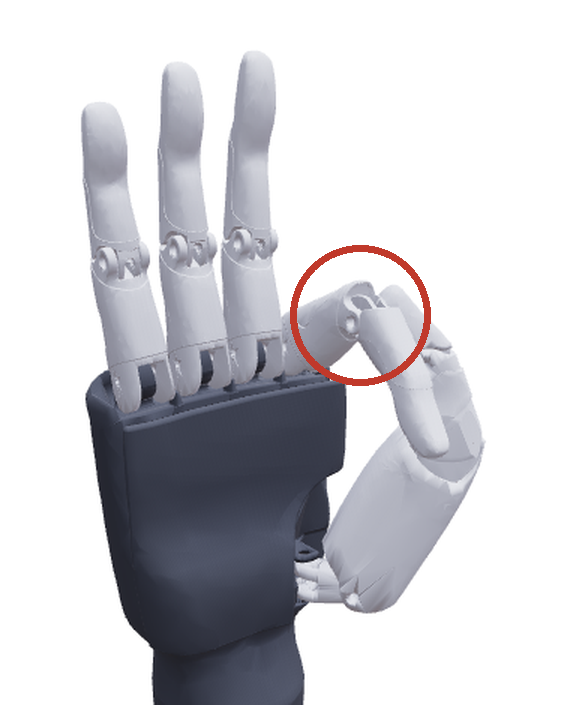 | 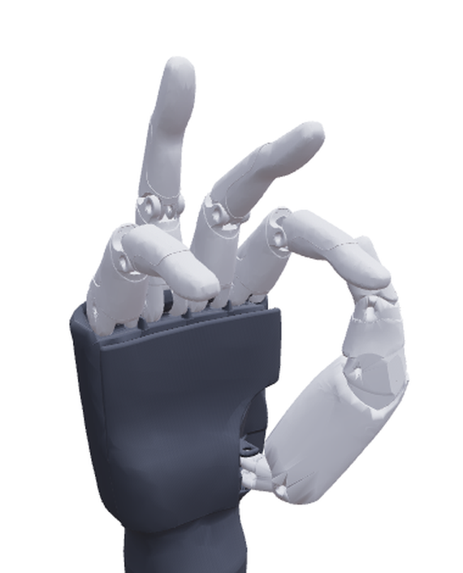 |

**Cube on the palm (experiment 04).** The cube is turned to a goal yaw with CEM-MPC and the Isaac cube in the planner, over 90
paired tasks:

| Branch-hand model | Success |
|---|--:|
| oracle | 87.8% |
| spec parameters | 81.1% |
| identified parameters | 51.1% |

A regularised refit (experiment 04b) gets 70.0% against 46.7% for the plain fit on seed 0.

<p align="center">
  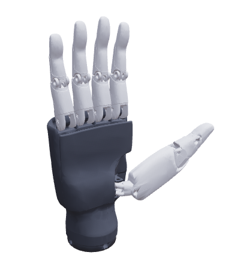
  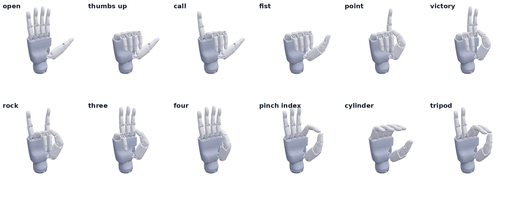
</p>

## Quick start

```bash
git clone https://github.com/AbdullahSohail15/hand-planning-control-stack.git && cd hand-planning-control-stack
export ISAAC_PYTHON=~/envs/isaac42/bin/python      # Isaac Sim 4.2 + Isaac Lab 1.2 (docs/installation.md)

cd INSPIRE && ./run_demo.sh                         # Inspire: crossing gestures, 3 controllers, 2 rendered clips (minutes)
cd ../SHADOW && QUICK=1 ./run_demo.sh               # Shadow: 1 gesture + 3 cube cases + videos (~75 min; needs step 0 of docs/shadow.md)
```

## Documentation

| Page | Contents |
|---|---|
| [docs/installation.md](docs/installation.md) | Isaac Sim / Isaac Lab, rendering environment, data not in git |
| [docs/shadow.md](docs/shadow.md) | Shadow Hand commands: self-exploration → fit → gesture and cube benchmarks → analysis → videos → demo |
| [docs/inspire.md](docs/inspire.md) | Inspire RH56 commands: setup → self-exploration → gestures → cube → analysis → videos → demo |
| [docs/method.md](docs/method.md) | The model, D-optimal exploration, CEM, RRT, iLQR/TVLQR, CBF, terminal state and fallback (with equations) |
| [SHADOW/README.md](SHADOW/README.md), [INSPIRE/README.md](INSPIRE/README.md) | Code layout: what every module and script does |
| `*/experiments/`, `*/result_summaries/` | Plan and full results of every experiment above |

## Repository layout

```
hand-planning-control-stack/
├── README.md, LICENSE
├── docs/                       installation, per-hand commands, method; media/ holds the README GIFs and images
├── SHADOW/
│   ├── run_demo.sh             both stacks, both tasks, videos
│   ├── run_python.sh           launcher for Isaac scripts
│   ├── shadow_dynamics/        library: Isaac environment, tendon hand model, RRT-Connect, iLQR/TVLQR, CBF, CEM-MPC
│   ├── shadow_viz/             numpy forward kinematics + viser replay (videos)
│   ├── scripts/                identify/ evaluate/ analyze/ render/ train/ tools/
│   ├── artifacts/              identified hand models, PPO proposer, cube models, 1-minute exploration data
│   └── experiments/, result_summaries/
└── INSPIRE/
    ├── run_demo.sh             crossing gestures + clips
    ├── run_python.sh           launcher for Isaac scripts (puts ../SHADOW on PYTHONPATH)
    ├── inspire_dynamics/       Isaac scene, servo-linkage model, exploration, controllers, kinematics
    ├── scripts/                setup/ identify/ evaluate/ analyze/ render/
    ├── assets/inspire_hand/    simulation URDF, meshes (dex-urdf, MIT), gesture library
    ├── artifacts/              identified models, results, replay clips
    └── experiments/, result_summaries/
```

## Notes

- All results are in simulation; the next step is to run the gesture benchmark on the real Inspire RH56.
- Isaac's RTX renderer could not create a device on our GPUs. Physics therefore runs headless, and videos are replays of the recorded
  joint trajectories. The motion in the videos is the simulated closed loop.
- The Shadow Hand meshes come from NVIDIA's Isaac Lab asset and are not included; `docs/shadow.md` step 0 exports them.

## Licence

Code: MIT ([LICENSE](LICENSE)). The Inspire hand asset keeps its dex-urdf licence (`INSPIRE/assets/inspire_hand/LICENSE.txt`).
